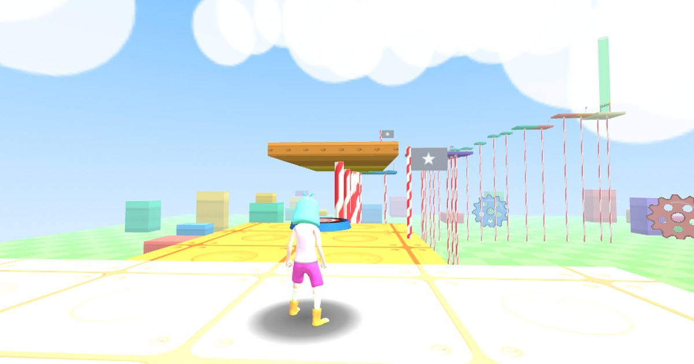

# TRAMPOLINE CHASER 3D

おもちゃ工場の空に浮かぶコースを、トランポリンで跳ねて進む3Dレースゲームです。跳んでいる間は好きな方向へ動けるので、浮いている床に飛び乗りながらゴールを目指します。ブラウザだけで遊べて、最大6人でオンラインのレース対戦もできます。



## 遊び方

| 操作 | パソコン | スマホ |
|---|---|---|
| 移動 | WASD / 矢印キー | 画面の左半分をドラッグ |
| 視点 | マウス（画面をクリックで固定） | 画面の右半分をドラッグ |
| 旋回 | Q / E | — |
| 波動（相手を吹き飛ばす） | 左クリック | WAVE ボタン |
| 最後に通った旗まで戻る | R | — |
| 一人称 / 三人称の切り替え | V | 1ST / 3RD ボタン |
| 消音 | M | — |

- **1人でタイムアタック**：ゴールまでのタイムを競います。ステージごとのベストタイムがブラウザに記録され、クリアすると次のステージが選べるようになります。ステージが進むほどコースが長く、高く、足場が小さくなります。
- 落ちても、最後に通ったチェックポイントの旗から再スタートできます。

### コースのしかけ

| しかけ | 内容 |
|---|---|
| トランポリン | 真上に高く跳ね上がる。上がっている間に横へ動いて、上の床に飛び乗る |
| スーパートランポリン（金色・光の輪） | ふつうの数倍の高さまで打ち上げる。空高く浮かぶ床へ飛び乗る |
| ダイブトランポリン（ピンク・光の柱） | ピンクの矢印の先から飛び降りて乗ると、落ちた高さ以上に跳ね返る。歩いて乗っても少ししか跳ねない |
| 発射台（オレンジの矢印） | 前方へ大きく打ち出す。着地すると少しの間ダッシュになる |
| 動く床・エレベーター（水色） | 往復・上下する床。乗ると一緒に運ばれる |
| 回転するバー | 床の上をなぎ払う。当たると弾き飛ばされる |
| ベルトコンベア | 乗っている間、流れる向きへ押される（逆向きや横向きもある） |
| 崩れる床（ビスケット） | 乗ると少しで崩れ落ちる。しばらくすると元に戻る |
- **ルームを作る / ルームに入る**：ホストがルームを作ると4桁のコードが出ます。ほかの人はそのコードを入力して参加します（最大6人）。
- タイトル画面とロビーで、4体のキャラクターから好きなものを選べます。

### 対戦のルール

- 全員が同じ場所からスタートし、最初にゴールした人の勝ち。最後の1人がゴールした時点でレースが終わります。
- ポイントは、ビリの到着タイムが1位に、ブービーのタイムが2位に……という順で加算されます。
- ライフ制です。ビリになるとライフが1減り、トップになると1増えます（2人対戦のときは増えません）。ライフが0になると退出し、ほかのプレイヤーの視点で観戦できます。
- コースは毎回自動で作られ、レースを重ねるごとに長く難しくなります。
- 黄色いジェムを取ると加速し、ルーレットで「雷」「トランポリン封鎖」「暗闇」のどれかが発動して、ほかのプレイヤー全員に効きます。

## GitHub Pages で公開する手順

1. GitHub で新しいリポジトリを作ります（例：`trampoline-chaser`）。公開範囲は **Public** にします。
2. このフォルダの中身を**フォルダ構成のまま**リポジトリに入れます。
   - ブラウザで行う場合：リポジトリの画面で「Add file」→「Upload files」を選び、このフォルダの中身をまとめてドラッグ＆ドロップして「Commit changes」。
   - `.nojekyll` は隠しファイルなので、ドラッグで入らなかった場合は「Add file」→「Create new file」でファイル名 `.nojekyll`（中身は空）を作ってください。
3. リポジトリの **Settings** → **Pages** を開き、「Build and deployment」の Source を **Deploy from a branch**、Branch を **main** と **/ (root)** にして Save します。
4. 1〜2分待つと、同じ画面の上部に公開URL（`https://ユーザー名.github.io/trampoline-chaser/`）が表示されます。

更新するときは、変更したファイルを同じ場所に上書きアップロードするだけで、数分後に公開ページへ反映されます。

### 手元で動作確認する場合

`index.html` をダブルクリックで直接開くと、ブラウザの制限で音楽とキャラクターが読み込めません。このフォルダで簡易サーバーを起動して開いてください。

```
python3 -m http.server 8000
```

ブラウザで `http://localhost:8000/` を開きます。

## 注意

- オンライン対戦は、接続の仲介に PeerJS の公開サーバー（`0.peerjs.com`）を使っています。仲介サーバーが混雑や停止していると、ルームを作れないことがあります。つながったあとのゲームのやり取りは、参加者どうしで直接行います。
- 学校や会社のネットワークなど、通信が制限された環境では対戦につながらない場合があります。

## フォルダ構成

```
index.html              ゲームの画面
css/style.css           見た目
js/game.js              ゲーム本体
js/vendor/              three.js r128・GLTFLoader・SkeletonUtils・PeerJS 1.5.4
assets/audio/           BGM・効果音
assets/characters/      キャラクター4体（.glb）と選択画面の顔写真（.jpg）
assets/favicon.png      タブのアイコン
assets/og.jpg           URLを共有したときに表示される画像
```

素材と使用ライブラリのクレジットは [CREDITS.md](CREDITS.md) を参照してください。
